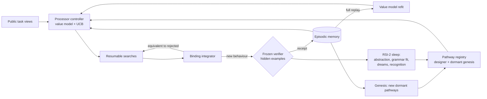

# RSI-3 architecture

RSI-3 is a closed memory-feedback loop wrapped around RSI-2's frozen program
synthesizer. It replaces exactly one thing in RSI-2: how the wake phase spends
its candidate-evaluation budget. Everything else — the typed DSL, evaluator,
enumerator, external corpus and splits, abstraction learning, grammar fitting,
dreaming, and the recognition model — is RSI-2's code, called with RSI-2's
arguments.

## Why the wake phase

RSI-2's measured result is a null: 2/12 TEST on every arm and seed, no library
entry adopted, no heuristic adopted (`rsi2/RESULTS.md`). Its failure analysis
(`rsi2/research/FAILURE_ANALYSIS.md`) located a concrete waste: across the 24
FULL development rounds, always-unsolved TRAIN tasks consumed 46,080 of 46,498
wake candidates (99.1%). Each generation retried every unsolved task from the
beginning of an enumeration whose order had not changed. RSI-2's own TRAIN
diagnostics show depth matters: plain enumeration verifies 6/36 at B64 and 8/36
at B640 (`rsi2/research/BOOTSTRAP_RESULTS.md`). The processor resource RSI-2
can measure is the candidate budget; that is what RSI-3 regulates.

## Components

| Concept | Module | What it does | What it does not do |
| --- | --- | --- | --- |
| Sensory transduction | `loop.standardized_features`, `integrator.probe_inputs` | RSI-2's 32 public task features, standardized over TRAIN; probe inputs derived from public inputs | never reads hidden examples |
| Dormant pathway store | `pathways.PathwayRegistry` | designer pathways (`prior`, `recognized`) plus `analog:<S>` pathways created from each verified solution; analog pathways are born dormant with no search state and no budget | adds no primitive and no library entry |
| Dormant state that resumes | `resumable.ResumableSearch` | RSI-2's heuristic-free search split into windows; an unchanged grammar resumes past its searched prefix instead of re-evaluating it | resumes nothing across a grammar change (fingerprint mismatch discards the frontier) |
| Dynamic pathway activation | `controller.Controller` | each chunk of candidates goes to the slot with the highest value-model probability plus a UCB bonus; dormant pathways wake through the bonus and keep budget only on replayed evidence | no hand-set activation thresholds |
| Memory-feedback engine | `memory.EpisodicMemory`, `value_model.ValueModel` | every window is an episode; the value model is refit from scratch each generation on a full replay of episodes | no parameter anchor, no consolidation gate, no rollback of the model |
| Processor controller | `controller`, `loop.Runtime.wake` | allocates the per-generation cap B_wake × \|TRAIN\|; solved tasks and exhausted slots get nothing; one verification per task per generation | does not change the cap |
| Binding integrator | `integrator.BindingIntegrator` | binds a new public match to remembered behaviour by probe signature; a match equivalent to a verifier-rejected program is skipped and the search continues; verified solutions are bound with provenance | never submits more than one program per task per generation |
| Independent verifier | `verifier.FrozenVerifier` | the only module that reads hidden examples; issues receipts; one query per task per generation | is never updated, tuned, or selected by any outcome |
| Failure memory | `memory.FailureMemory`, `resumable.ResumableSearch` | per task, the programs that failed its public examples; skipped without charge by every pathway and across grammar changes | never skips a program that has not failed that task's public examples |
| Self-model and concept invention | `selfmodel.SelfModel`, `loop.Runtime.invent`, `PathwayRegistry.base_grammar` | decomposes the system's verified programs into parts and runs candidate concepts on probe inputs; invents parts, powers, compositions and unnamed integers from them; adds them to the generation's search grammar at a tenth of the pseudocount; adopts a concept into the library only when a program using it is verified | adds no primitive; reads no hidden example, VALIDATION or TEST; keeps no concept that has not earned a verified solve |
| Backward decomposition | `decompose.py`, `PathwayRegistry.add_decompose_pathways` | ported from `verified-code-rsi`: `map` / `filter` / `any` / `all` / prepend skeletons applied when a task's public examples have their shape; the typed hole is enumerated by RSI-2's enumerator, and each composite costs one candidate evaluation | names no task and contains no solution; every skeleton has a hole that search must fill |
| Meta-RL search policy | `metarl.MetaPolicy`, `loop.Runtime._meta_wake` | inside each task's even share, chooses prior / invented / skeleton chunks from the task's public shape and its own history there; fitted across tasks on the full replay of chunk episodes (verifier receipts as reward); `meta_wipe` refits on one generation only | is never fitted on VALIDATION outcomes |
| Fold skeletons | `decompose.Fold`, `fold_skeletons` | `fold h init` with a typed step hole and the empty-list answer of the output type, for every list-input task (opt-in) | names no task |
| Self-play | `loop.Runtime._self_play` | each generation, imagines tasks by sampling a skeleton hole from the system's grammar and running it on TRAIN public inputs; the generating skeleton is a rewarded episode for the policy on that shape | imagined tasks are never verified, searched or added to anything but the policy's replay |
| Conjugation | `decompose.conjugate_skeletons`, `PathwayRegistry.refresh_conjugates` | per generation, for each verified list program C that is an involution on an unsolved task's public data, the skeletons that fit the transformed task (C x, C y), composed as C . S[h] . C | uses only the system's own verified programs and public examples |
| Behavioural search | `behave.py`, `PathwayRegistry.add_behave_pathways`, `Runtime._practice` | bottom-up search that keeps one program per behaviour on the public inputs (observational equivalence), with deduction: list outputs split through `cons` into element targets, booleans through `not`, and witness functions that compute the constant argument of a binary operation from one behaviour and the target; built from RSI-2's first-order primitives plus every first-order library entry, ordered by the fitted grammar; one meta-RL action per problem (the whole program, each pointwise skeleton hole); the policy also practises these actions on its self-play tasks | reads public examples only; charges every behaviour kept, every target-equal alternative and every assembled program; adds no primitive |
| Honest practice | `loop.Runtime._practice_searches` (`selfplay_honest`) | on each imagined task, runs the prior and every fitting skeleton for one chunk and records each action's actual outcome, as the behavioural actions already were | imagined tasks are never verified; no action is credited by construction |
| Pool portfolio | `behave0:<kind>` pathways (`behave_dual`), `metarl.shape_features(fixed_length=...)` | every behavioural problem also offered from RSI-2's primitives only, in a fixed order, beside the library version; an optional fixed-output-length shape flag | the policy, not the designer, chooses which pool to search |
| Transfer measurement | `longrun.agent_validation` | the arm's own TRAIN-trained solver on each VALIDATION task at B_eval, with one verifier query; equals VALIDATION for prior-only arms | is not used by any learning component |
| Self-continuity guard | `continuity.ContinuityGuard` | audits each self-rewrite: the new self must re-derive solved TRAIN tasks and pass self-written exams; in `restore` mode it can rehearse or revert | off in every registered arm; its study was abandoned before any registered run (PREDICTIONS_SELF_CONTINUITY.md) |

## Design decisions and their evidence

**D1 — Replay, not anchoring, for continuous learning.** The value model is
refit from scratch on all episodes every generation. In
`studies/regulation_toy.py` (5 seeds; `studies/REGULATION_TOY_RESULTS.md`),
memory replay alone kept an injected beneficial change (B 0.0007) and repaired
an injected harmful one (A recovery 0.97 on a log scale), while every condition
that pulled parameters toward a reference — fixed, strong, or updated only when
memory showed no loss — lost the old capability, the new one, or both (fixed
reference: A rose from 0.005 to 0.42–0.66). The evidence-gated reference never
passed its gate in 3,000 steps after the harmful patch; all recovery in that
condition came from replay. `RSI3_NO_REPLAY` is the matching ablation here.

**D2 — Gates only where they earn their place.** RSI-3 keeps two gates: memory
entry (a label needs an authentic verifier receipt) and RSI-2's unchanged MDL
gate on library adoption. It adds no rollback or reference gate to the value
model or the controller. The toy study measured what a gate on continuous
learning costs; discrete, expensive changes and contamination risk are where a
gate pays.

**D3 — The pathway set grows from verified experience.** A router that only
chooses among designer-written modules keeps the design space closed. Here
every verified solution creates a new dormant pathway, and every pathway,
designer or generated, competes for budget through the same value model.
`RSI3_NO_GENESIS` measures whether this contributes.

**D4 — The verifier stays outside the loop it judges.** Every component that
learns does so from receipts. None of them can issue a receipt, read hidden
examples, or change the verifier. A planted self-grading pathway is rejected by
test (`tests/test_verifier_memory.py`). The query rate equals RSI-2's.

**D5 — Physical cost is reported, not hidden.** Deeper candidates are larger
programs and cost more interpreter time. Logical budgets are equal across arms;
CPU is reported per arm.

## What RSI-3 does not include

- RSI-2's Stage-4 heuristic synthesis. RSI-2 measured that it never adopted a
  heuristic while consuming 8,518 of FULL's 11,358 CPU seconds; RSI-3 runs with
  the constant-zero heuristic, i.e. RSI-2's NO_HEURISTIC configuration, in every
  arm including the RSI-2 baseline.
- Any change to the frozen primitives, constants, evaluator, corpus, splits, or
  TEST. The library is the only part of the language that grows: through
  RSI-2's unchanged MDL learner in every arm, and, in the invention arm, through
  concepts the system invented and the frozen verifier confirmed by a solve.
- Any claim that budget reallocation is recursive self-improvement. The loop
  improves how a fixed search procedure spends its budget, using a learned
  model trained on its own verified outcomes. Whether that changes certified
  capability is what the experiment measures, against pre-registered
  predictions (PREDICTIONS.md) and the RSI-2 arm.

## Claim boundary

The claim is exactly the measured trajectory in RESULTS.md, on the 36 TRAIN
tasks (hidden-example verified) and 12 VALIDATION tasks of RSI-2's frozen
corpus, at the registered budgets and seeds. Nothing in this package asserts
general intelligence, unbounded capability, or an intelligence explosion.
