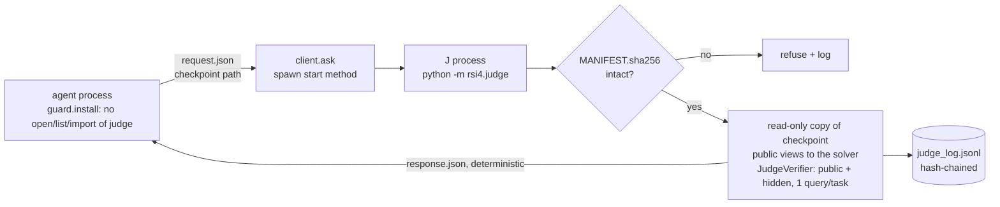

# RSI-4 architecture

RSI-4 is a four-loop continual learner built on the latest scored RSI-3 arm,
judged by an external judge J that nothing the system controls can reach
([OWNER_DIRECTIVE.md](OWNER_DIRECTIVE.md), v3 of 2026-11-06). This file
describes what exists now and is extended at the end of every phase.

**Status.** Phase 0 (harness before agent) is built: the stages and J's
pools, J itself, the sealing audit, the run workflow and red-team tests
R1–R3 ([RESULTS_P0.md](RESULTS_P0.md)). No agent learning code exists yet;
loops 1–4 arrive in Phases 2–4.

## The seven parts on the repository

| Part | Where | Status |
| --- | --- | --- |
| S, slow knowledge | RSI-2 grammar, MDL library, recognition; rsi3 invented concepts | imported read-only from rsi2/rsi3 |
| M, sparse memory | `rsi3.memory` episodic and failure memory, `rsi3.pathways`, the MetaPolicy replay | imported read-only |
| F, fast state | `rsi4/fast_store.py` | Phase 2 |
| C, compute controller | `rsi4/compute.py` | Phase 2 |
| E, experience | MetaPolicy chunk episodes, extended with predicted yield, observed progress and surprise | Phase 2 |
| G, write gate | rsi3's receipt guard (unchanged); `rsi4/offer.py` | Phase 3 |
| J, judge | `rsi3.verifier.FrozenVerifier` for training receipts (unchanged); `rsi4/judge/` for everything else | **built** |

## J, the judge

**Isolation.**

- J runs in its own process. `rsi4/client.py` starts it with
  `multiprocessing`'s spawn start method; the package is run only inside the
  child (`runpy.run_module`). The child inherits no module state.
- The agent sends a checkpoint path and a request, and reads back a response
  file. A response contains only deterministic content: the same checkpoint
  and request give byte-identical responses (R3).
- J copies each checkpoint, marks the copy read-only, hashes it and unpickles
  a fresh object per seed. The solver receives public views only. J's
  `JudgeVerifier` holds the hidden examples, checks every public and hidden
  example, and allows one query per task. "Solved" is J's verdict, never the
  solver's claim (R1c plants a solver that claims everything; J counts 0).
- J's seed is in `rsi4/judge/seed.json`. Only the judge process opens it.

**Sealing, two halves.**

1. *Static* (`rsi4/judge/audit.py`): an AST audit of every agent module
   (everything under `rsi4/` outside `judge/` and `tests/`). It fails on any
   import of `rsi4.judge` (absolute or relative), any dynamic importer or
   code runner, any string literal naming the judge package, a path into it,
   the pools, the seed file, the manifest or the source file, any attribute
   containing `hidden`, and frame or closure introspection. J runs it at
   every `run_start` and refuses the run on a finding; the test suite runs it
   on every build. `client.py` (which names J's package to start it) and
   `guard.py` (which names J's directory to block it) are the only exemptions.
2. *Run time* (`rsi4/guard.py`): a PEP 578 audit hook installed first thing
   in the agent's `main()` refuses `open`, `os.listdir` and `os.scandir` of
   any path under `rsi4/judge/` or of `list_tasks2.json`, and any import of
   J's package. This covers paths assembled at run time, which no static
   audit sees.

**Integrity.** `MANIFEST.sha256` holds the SHA-256 of every file under
`rsi4/judge/` and of the stage-train file. Every request first checks the
live files against it and is refused on a difference. `run_start` records
one hash of J's tree and of the registered config; `run_end` recomputes
both, and any change voids the run (R1b, including a change made together
with a rewritten manifest).

**The ledger.** Every J decision, refusal and error is appended to a
hash-chained `judge_log.jsonl` (each line hashes the previous line's hash
and its own entry). A run's own ledger lives in its output directory. Every
operation that consumes a single-use pool, and every gate statistic, goes to
the canonical ledger `rsi4/ledger/judge_log.jsonl`, which a request cannot
redirect. `rsi4/judge/replay.py` recomputes every logged decision from the
logged inputs (R7). J's CPU time goes to `judge_costs.jsonl`, outside every
budget.

**Operations and the pools each may read.**

| op | reads | decides |
| --- | --- | --- |
| `run_start` / `run_end` | nothing | void or valid |
| `evaluate` | `stage_eval_S1..S3`; report-only: `exposed:<partition>`, `report:train`, `report:stage_train_S<k>` | nothing (reported counts) |
| `sleep_check` | `probe`, before and after a discrete sleep change | keep or revert |
| `select` | `selection_r<k>`, once per round | which candidate goes to confirmation |
| `confirm` | `confirmation_r<k>`, once, only the selected candidate; then burned | adopt or not |
| `final_test` | `final_test_2` + `final_test_3`, once | Gate 4 |
| `compare` | J's logged evaluations | exact one-sided sign tests, Holm-corrected |
| `metrics` | J's logged stage-eval evaluations | ACC, BWT, FGT, FWT with 95% bootstrap CIs |

**Statistics** (`adopt.py`, `metrics.py`). The unit is the task; a task is
solved when solved on at least 2 of 3 seeds (F7). Exact one-sided sign test
on discordant pairs (8 wins vs 1 loss: p = 0.020; 7 vs 2: p = 0.090). Loop-4
adoption needs all pairs evaluated, p ≤ 0.05 and at most 5 losses; Gate 4
allows at most 8. Bootstrap: 10,000 resamples of each stage's 100 tasks,
paired across checkpoints, fixed seed.

**Rule bounds.** J holds its own copy of the directive's rule table and
rejects any candidate outside it. B_wake, B_eval, the search limits, the
verifier, the MDL gate, the pools, δ_sleep, α, the regression budget and the
seeds are not rules and cannot be sent as rules; J also refuses any config
whose B_eval or search limits differ from the registered ones.

## The sleep check: what it is for

The sleep check prices discrete changes to S; it is **not** the mechanism
expected to produce gains. The Owner decided on 2026-10-29 that a guard
which only prevents losses cannot produce a capability leap (F4), and
`ContinuityGuard` stays off in every arm. J evaluates the learned solver
with S before and after a discrete sleep change (a library entry or a
concept added or removed) on the 60 probe tasks at B_eval = 64, and reverts
when losses − wins ≥ 2. Ablation A4 (a placebo revert at the measured revert
rate) measures what the check costs, and Gate 3 drops it for Phase 4 unless
it pays. The probe pool feeds a decision, so no probe number is ever reported
as a result.

## Task streams and pools

Built by `rsi4/judge/pools.py` from DreamCoder's `data/list_tasks2.json` at
cb0e63f (174,258 records), with `rsi3.fresh`'s eligibility and 8-public
example protocol. One record per name (the file repeats names), so stages and
pools are disjoint by name. Exclusions before any draw: the FRESH names,
corpus names, and records behaviourally equal to a COMPOSE-24 task.

- **Stages.** 51 routines split by sha256(name + J seed) mod 3 into groups
  of 17/20/14. Stage i holds the two-stage pipelines whose two routines are
  both in group i − 1: 279/838/266 candidates, from each of which 36
  stage-train and 100 stage-eval tasks are drawn. Stage-train tasks are in
  `rsi4/data/stage_train.json` (agent-facing, like TRAIN; their hidden
  examples reach only `FrozenVerifier`). Stage-eval tasks are J's.
- **J pools**, from the remaining 3,502 two-stage names: probe 60; per round
  selection 100 and confirmation 200 (three rounds); final test 200
  two-stage plus 100 three-stage (from 98,564 eligible three-stage names).

## Fixed rules carried from RSI-2 and RSI-3

Python standard library and NumPy only; no network at run time; no
transformer or attention layer. No new primitive, hand-written library entry
or heuristic; the evaluator and the MDL gate are RSI-2's. TEST is never
opened. Exposed partitions (VALIDATION, RESERVE-NEAR, RESERVE-FAR,
RESERVE-FAR2, FRESH-1, FRESH-2, COMPOSE-24) are report-only and never gate,
tune or select anything. `rsi2/` and `rsi3/` are imported and never edited.

## Claim boundary

The claim is the measured trajectory at the registered budgets, seeds and
pools, in the form rsi3's results files use. Nothing in this package asserts
general intelligence, unbounded capability or recursive self-improvement
beyond what the gates measure.
